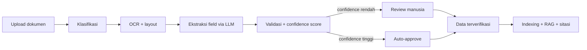

# DocuLens — Intelligent Document Processing with Human-in-the-Loop

> Sistem AI end-to-end untuk mengubah dokumen bisnis (invoice, receipt) menjadi data terstruktur yang terverifikasi, lengkap dengan confidence score, review manusia, dan pencarian berbasis RAG dengan sitasi.

**Status:** 🚧 Dalam pengembangan — lihat [Roadmap](docs/roadmap.md)

> _Nama proyek `DocuLens` adalah placeholder. Ganti sesuai keinginan._

---

## Masalah

Banyak perusahaan (terutama SME) masih memasukkan data dari invoice, PO, dan struk secara manual. Prosesnya lambat, mahal, dan rawan salah input. OCR saja tidak cukup karena hasilnya tidak terstruktur dan tidak ada cara untuk tahu mana hasil yang dapat dipercaya.

## Solusi



Fokus utama: **seberapa akurat** sistemnya, **seberapa terkalibrasi** confidence-nya, dan **berapa banyak kerja manual** yang bisa dihemat — semuanya diukur, bukan diklaim.

## Fitur

**MVP**
- [ ] Upload dokumen (PDF/JPG/PNG) dan antrean pemrosesan
- [ ] OCR + ekstraksi field ke JSON berskema (vendor, tanggal, total, item)
- [ ] Confidence score per field + aturan validasi
- [ ] UI review: gambar dokumen berdampingan dengan field, highlight yang ragu, edit & approve
- [ ] Audit log perubahan
- [ ] Pencarian + tanya jawab (RAG) dengan sitasi ke dokumen sumber
- [ ] Skrip evaluasi yang dapat direproduksi

**Setelah MVP**
- [ ] Dukungan PO dan jenis dokumen lain
- [ ] Perbandingan metode: Tesseract vs PaddleOCR, OCR+LLM vs VLM langsung dari gambar (qwen2.5vl)
- [ ] Reranker, dashboard lanjutan, RBAC lebih rinci

## Tech Stack

| Layer | Teknologi |
|---|---|
| Frontend | React / Next.js |
| Backend | FastAPI (Python) |
| Database | PostgreSQL + pgvector |
| OCR | PaddleOCR (baseline: Tesseract) |
| LLM | LLM lokal via Ollama (`hermes3`) untuk ekstraksi + RAG; `bge-m3` untuk embedding; `qwen2.5vl` sebagai VLM pembanding. Provider dapat diganti lewat interface `LLMClient` |
| Infra | Docker Compose |

Keputusan teknologi dan alasannya: [docs/decisions.md](docs/decisions.md)

## Hasil Evaluasi

_Akan diisi setelah baseline selesai. Rencana evaluasi: [docs/evaluation-plan.md](docs/evaluation-plan.md)._

| Eksperimen | Metrik | Hasil |
|---|---|---|
| E1 OCR: Tesseract vs PaddleOCR | CER / WER | TBD |
| E2 Ekstraksi: OCR+LLM | Field F1, exact match | TBD |
| E3 Kalibrasi confidence | ECE | TBD |
| E4 Auto-approve trade-off | % otomatis @ akurasi | TBD |
| E5 RAG | Faithfulness, citation precision | TBD |

## Struktur Repo

```
.
├── README.md
├── CLAUDE.md              # konteks & aturan untuk AI coding assistant
├── docs/                  # SRS, arsitektur, data model, evaluasi, roadmap
├── backend/               # FastAPI app, pipeline, worker
├── frontend/              # UI upload, review, search
├── eval/                  # skrip evaluasi & hasil eksperimen
├── data/                  # dataset (gitignored) + sampel kecil
├── docker/                # Dockerfile & compose
└── scripts/               # utilitas (download dataset, seed, dll)
```

## Quick Start

_Akan diisi saat M2 (backend jalan). Target akhirnya:_

```bash
ollama pull hermes3 && ollama pull bge-m3   # pastikan Ollama berjalan
cp .env.example .env
docker compose up --build
# Frontend: http://localhost:3000   API docs: http://localhost:8000/docs
```

## Dokumentasi

| Dokumen | Isi |
|---|---|
| [SRS](docs/SRS.md) | Kebutuhan fungsional & non-fungsional |
| [Architecture](docs/architecture.md) | Komponen, alur pipeline, sequence |
| [Data Model](docs/data-model.md) | Skema database |
| [Extraction Schema](docs/extraction-schema.md) | Kontrak JSON hasil ekstraksi |
| [Evaluation Plan](docs/evaluation-plan.md) | Metrik, dataset, eksperimen |
| [Roadmap](docs/roadmap.md) | Milestone & definition of done |
| [Decisions](docs/decisions.md) | Catatan keputusan teknis (ADR ringan) |
| [Vibe Coding Guide](docs/vibe-coding-guide.md) | Cara kerja dengan AI assistant |

## Keterbatasan (akan diperbarui)

- Awalnya hanya mendukung receipt/invoice dengan tata letak umum.
- Model LLM berjalan lokal (CPU/GPU laptop), sehingga latensi per dokumen lebih tinggi dibanding API cloud; angka latensi dan perangkat keras dilaporkan di hasil evaluasi.
- Dataset publik didominasi dokumen berbahasa Inggris/Asia; dokumen Indonesia diuji dengan data sintetis.
- Biaya dan latensi LLM per dokumen akan dilaporkan di hasil evaluasi.

## Lisensi

MIT (atau sesuaikan).
