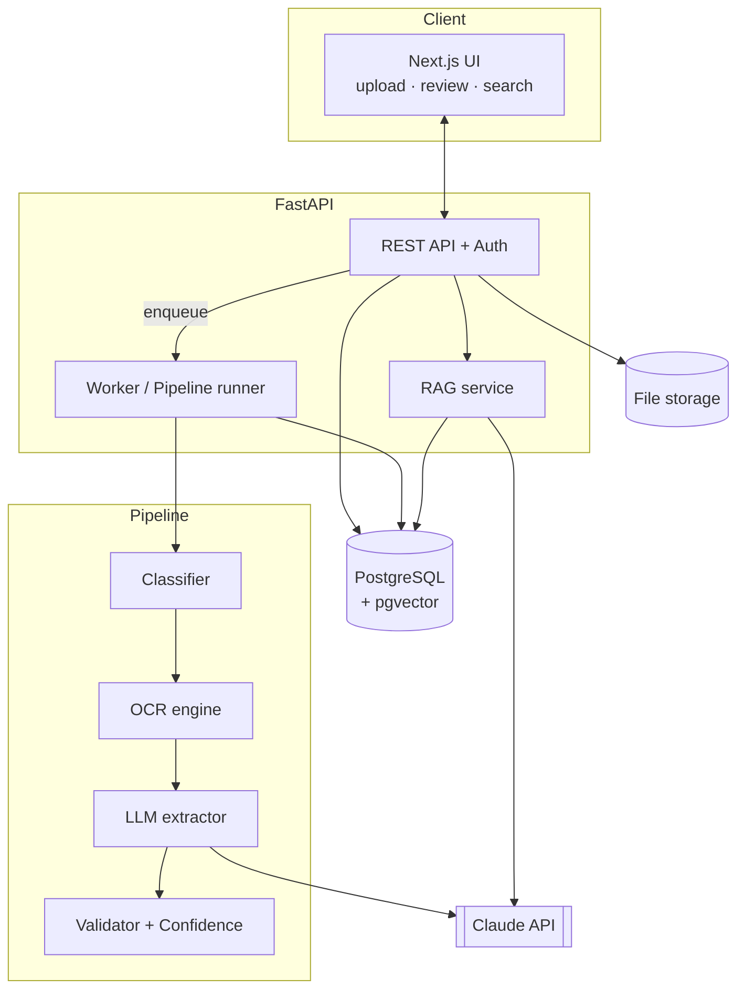
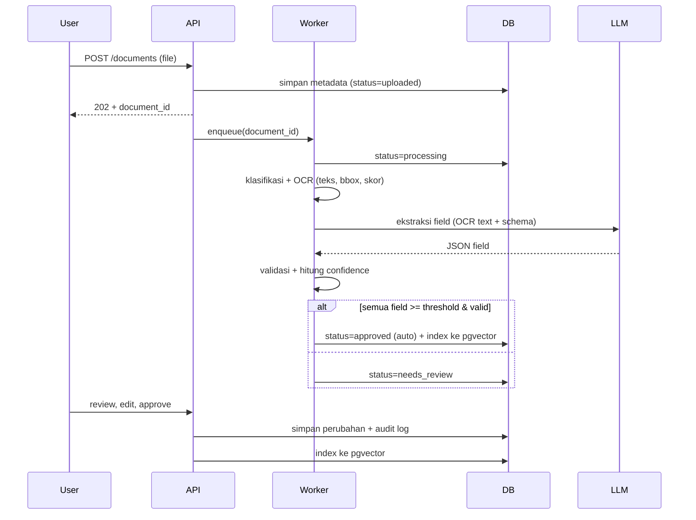

# Architecture

## 1. Gambaran Komponen



## 2. Alur Pemrosesan Dokumen



## 3. Tahap Pipeline (kontrak antar-modul)

Setiap tahap adalah fungsi murni yang menerima input terdefinisi dan mengembalikan output terdefinisi, supaya mudah diuji dan diganti (mis. Tesseract ↔ PaddleOCR).

| Tahap | Input | Output |
|---|---|---|
| Preprocess | file | daftar gambar halaman |
| OCR | gambar halaman | `OcrResult`: tokens `{text, bbox, score}` |
| Classify | `OcrResult` | `doc_type` + skor |
| Extract | `OcrResult` + schema | `ExtractionDraft`: field `{value, source_token_ids}` |
| Validate | `ExtractionDraft` | daftar hasil aturan (pass/fail + alasan) |
| Score | draft + validasi + OCR score | confidence per field |
| Route | confidence + threshold | status berikutnya |

## 4. Strategi Confidence (awal)

Confidence field = kombinasi tertimbang dari:
1. **Skor OCR** token sumber field.
2. **Hasil validasi** (mis. total cocok dengan jumlah item).
3. **Konsistensi ekstraksi** (opsional: jalankan LLM 2× dan bandingkan, atau cocokkan nilai dengan teks OCR).

Bobot awal sederhana, lalu dikalibrasi memakai data eval (lihat E3 di [evaluation-plan](evaluation-plan.md)). Jangan klaim "calibrated" sebelum diukur.

## 5. Pemrosesan Asinkron — Pendekatan Bertahap

1. **MVP:** FastAPI `BackgroundTasks` atau worker sederhana yang membaca tabel `jobs` di PostgreSQL (tanpa Redis).
2. **Lanjutan (opsional):** pindah ke Redis + RQ/Celery bila perlu retry/antrean lebih kuat.

## 6. Struktur Backend yang Disarankan

```
backend/app/
  main.py
  api/            # routers: auth, documents, search, ask, stats
  core/           # config, security, logging
  db/             # models, session, migrations (alembic)
  pipeline/       # preprocess, ocr/, classify, extract, validate, score, route
  rag/            # chunking, embedding, retrieval, answer
  services/       # document_service, review_service, audit_service
  schemas/        # pydantic models (termasuk extraction schema)
  tests/
```

## 7. Keamanan Singkat
- Password: argon2/bcrypt. Token: JWT berumur pendek atau session cookie httpOnly.
- Upload: whitelist MIME + cek magic bytes, ukuran maks., nama file diganti UUID.
- Prompt injection: teks OCR dianggap **data tidak tepercaya**; instruksi sistem dipisah dari konten dokumen, output LLM selalu divalidasi dengan schema.
- Secret hanya lewat environment variable.
