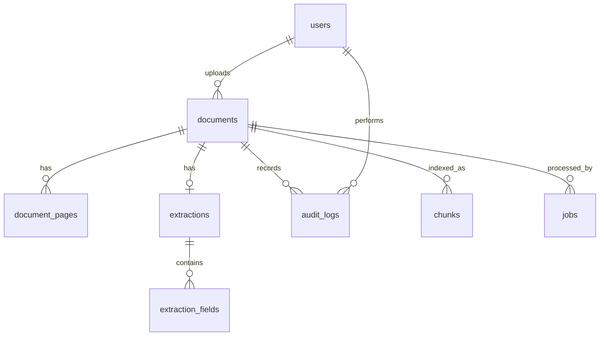

# Data Model

> Draf skema untuk PostgreSQL + pgvector. Sumber kebenaran akhir adalah migrasi Alembic di `backend/app/db/`.

## ERD



## Tabel

```sql
CREATE EXTENSION IF NOT EXISTS vector;

CREATE TABLE users (
  id            UUID PRIMARY KEY,
  email         TEXT UNIQUE NOT NULL,
  password_hash TEXT NOT NULL,
  role          TEXT NOT NULL CHECK (role IN ('admin','reviewer','viewer')),
  is_active     BOOLEAN NOT NULL DEFAULT TRUE,
  created_at    TIMESTAMPTZ NOT NULL DEFAULT now()
);

CREATE TABLE documents (
  id            UUID PRIMARY KEY,
  uploaded_by   UUID REFERENCES users(id),
  filename      TEXT NOT NULL,
  storage_path  TEXT NOT NULL,
  file_hash     TEXT NOT NULL,
  mime_type     TEXT NOT NULL,
  page_count    INT,
  doc_type      TEXT,                       -- receipt | invoice | other
  status        TEXT NOT NULL DEFAULT 'uploaded',
  error_message TEXT,
  created_at    TIMESTAMPTZ NOT NULL DEFAULT now(),
  updated_at    TIMESTAMPTZ NOT NULL DEFAULT now()
);
CREATE INDEX ON documents (status);
CREATE INDEX ON documents (file_hash);

CREATE TABLE document_pages (
  id          UUID PRIMARY KEY,
  document_id UUID REFERENCES documents(id) ON DELETE CASCADE,
  page_number INT NOT NULL,
  image_path  TEXT NOT NULL,
  ocr_engine  TEXT,
  ocr_tokens  JSONB,                        -- [{id,text,bbox,score}]
  UNIQUE (document_id, page_number)
);

CREATE TABLE extractions (
  id             UUID PRIMARY KEY,
  document_id    UUID UNIQUE REFERENCES documents(id) ON DELETE CASCADE,
  model          TEXT,
  prompt_version TEXT,
  latency_ms     INT,
  input_tokens   INT,
  output_tokens  INT,
  cost_usd       NUMERIC(10,6),
  created_at     TIMESTAMPTZ NOT NULL DEFAULT now()
);

CREATE TABLE extraction_fields (
  id             UUID PRIMARY KEY,
  extraction_id  UUID REFERENCES extractions(id) ON DELETE CASCADE,
  field_name     TEXT NOT NULL,             -- vendor, invoice_date, total, ...
  value_raw      TEXT,                      -- hasil model
  value_final    TEXT,                      -- setelah review manusia
  confidence     REAL,
  validation     JSONB,                     -- [{rule, passed, reason}]
  source_page    INT,
  source_bbox    JSONB,
  was_corrected  BOOLEAN NOT NULL DEFAULT FALSE,
  UNIQUE (extraction_id, field_name)
);

CREATE TABLE audit_logs (
  id          UUID PRIMARY KEY,
  document_id UUID REFERENCES documents(id) ON DELETE CASCADE,
  user_id     UUID REFERENCES users(id),    -- NULL = sistem
  action      TEXT NOT NULL,                -- field_edited | approved | rejected | reprocessed ...
  field_name  TEXT,
  old_value   TEXT,
  new_value   TEXT,
  created_at  TIMESTAMPTZ NOT NULL DEFAULT now()
);

CREATE TABLE chunks (
  id          UUID PRIMARY KEY,
  document_id UUID REFERENCES documents(id) ON DELETE CASCADE,
  chunk_text  TEXT NOT NULL,
  source_ref  JSONB,                        -- {page, field, bbox}
  embedding   vector(1024)                  -- sesuaikan dimensi dengan model embedding
);
CREATE INDEX ON chunks USING hnsw (embedding vector_cosine_ops);

CREATE TABLE jobs (
  id          UUID PRIMARY KEY,
  document_id UUID REFERENCES documents(id) ON DELETE CASCADE,
  status      TEXT NOT NULL DEFAULT 'queued', -- queued | running | done | failed
  attempts    INT NOT NULL DEFAULT 0,
  last_error  TEXT,
  created_at  TIMESTAMPTZ NOT NULL DEFAULT now(),
  updated_at  TIMESTAMPTZ NOT NULL DEFAULT now()
);

CREATE TABLE eval_runs (
  id          UUID PRIMARY KEY,
  experiment  TEXT NOT NULL,                -- E1..E5
  config      JSONB NOT NULL,
  metrics     JSONB NOT NULL,
  git_commit  TEXT,
  created_at  TIMESTAMPTZ NOT NULL DEFAULT now()
);
```

## Catatan Desain
- `value_raw` vs `value_final` memungkinkan kita mengukur seberapa sering model salah (`was_corrected`) tanpa kehilangan jejak.
- `audit_logs` bersifat append-only; jangan sediakan endpoint update/delete.
- Dimensi `vector(...)` harus sama dengan model embedding yang dipilih.
